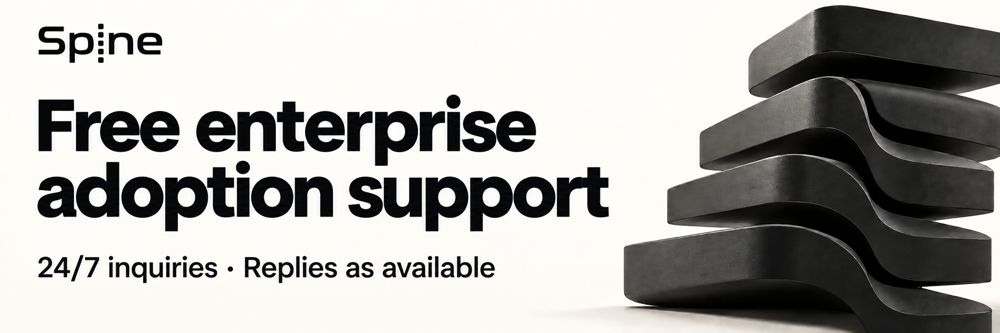
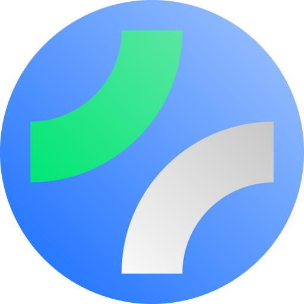

<p align="center">
  <a href="README.md">한국어</a> Spine `v0.6.0` provides a public HTTP execution contract and a separate `spine-echo-platform` module. Create HTTP apps with `platform.New()`; `spine.New()` selects no HTTP implementation. See the [migration guide](docs/migration/http-adapter-modules.md) and [minimal demo](cmd/demo/README.md).
</p>

> The unreleased issue #9 development branch keeps the public HTTP contract in Spine and distributes the Echo integration as a separate platform module. Create HTTP apps with `platform.New()`; kernel `spine.New()` selects no HTTP implementation. See the [migration guide](docs/migration/http-adapter-modules.md) and [local demo](cmd/demo/README.md).


# 🦴 Spine
<p align="center">
  
</p>

**Spine is a backend framework that makes request execution explicit.**  
It does not hide how a request is resolved and executed.

## Core ideas

- Fixed execution order and responsibilities
- Method signature is the API contract
- Semantic input types: `path.*`, `query.*`, `httperr.*`

## Free enterprise adoption support

[](https://github.com/NARUBROWN/spine/issues/new?title=%5BAdoption%20support%5D)

Bring the business architecture and development practices you know from Spring or NestJS to Go.
Any company or development team evaluating or using Spine can request free support directly from the maintainer.
There is no limit on the number of participating companies and no fixed support end date.

- Assess whether Spine fits your service and review the responsibilities and dependencies of controllers, services, and repositories.
- Review initial setup and relevant code to help with dependency injection (DI) and framework usage.
- Reproduce errors and assess workarounds or fixes based on the cause.

Submit inquiries 24/7. The maintainer responds when available, with no guaranteed response or recovery time.
Support takes place asynchronously through text, code, and logs. Meetings can be arranged when further discussion is needed.

Inquiries are prioritized by production impact and available workarounds.
Within the same priority, arrival order and the impact on other users are also considered.

| Inquiry type | Criteria |
|---|---|
| Urgent | A core production function is unavailable or a data integrity incident is in progress |
| Adoption blocker | A build, startup, or core function error prevents adoption or development |
| General | Usage or architecture questions, focused code reviews, or errors with a workaround |
| Improvement | Suggestions for features, usability, documentation, or examples |

Your team develops business features, operates the service, and pays for infrastructure and external services.
Full project development, continuous operations, or ongoing development of features specific to your company require a separate scope discussion.

**[Start an adoption or support inquiry](https://github.com/NARUBROWN/spine/issues/new?title=%5BAdoption%20support%5D)**

Describe your service, current stack, intended adoption scope, and questions.
For errors, include your Spine and Go versions, expected and actual behavior, and minimal reproduction steps.
GitHub Issues are public. Share a sanitized summary or minimal reproduction without confidential information.

## Recommended environment

- Recommended Go version: **1.27.3**

## Links

- Official site: https://spine.na2ru2.me/en/
- Spine CLI (project generation and execution-contract inspection): https://github.com/NARUBROWN/spine-cli
- Bun ORM + Swagger integration example project: https://github.com/NARUBROWN/spine-user-demo
- Kafka MSA example project: https://github.com/NARUBROWN/spine-simple-msa-demo
- Simple WebSocket chat example project: https://github.com/NARUBROWN/spine-simple-chat-demo

---

## Run an app with the Echo platform

Select the platform module and call Run on the Spine App.

```sh
go get github.com/NARUBROWN/spine-echo-platform@v0.1.0
```

```go
package main

import (
    "log"

    platform "github.com/NARUBROWN/spine-echo-platform"
    "github.com/NARUBROWN/spine/pkg/boot"
)

func main() {
    app := platform.New()
    if err := app.Run(boot.Options{Address: ":8080", HTTP: &boot.HTTPOptions{}}); err != nil {
        log.Fatal(err)
    }
}
```

## Spine CLI

[Spine CLI](https://github.com/NARUBROWN/spine-cli) is a Go CLI that generates Spine projects and components
and inspects HTTP, DI, interceptor, consumer, and WebSocket execution contracts from source code. It also
supports contract snapshots and diffs, plus OpenAPI and AsyncAPI exports.

Go 1.27.3 is recommended. Install the short `spine` command as follows.

```sh
go install github.com/NARUBROWN/spine-cli/cmd/spine@v0.1.4
spine version
```

Create a project or inspect the contract of an existing one.

```sh
spine new todo-api --module github.com/acme/todo-api
spine context --root ./todo-api --json
spine contract check --root ./todo-api --warnings-as-errors --json
spine verify --root ./todo-api --warnings-as-errors --json
```

The generator does not overwrite existing files by default. Before applying a change, review the dry-run diff
and `base_hash`, then pass that same hash to `--if-match`.

```sh
spine g resource order --root . --dry-run --json
spine g resource order --root . --if-match <base_hash> --json
```

Spine CLI `v0.1.4` pins newly generated projects to Spine `v0.5.1`. When using it with another version or a
development snapshot of this repository, check the generated `go.mod` and the contract results. See the
[Spine CLI documentation](https://github.com/NARUBROWN/spine-cli#readme) for the complete command set and
precise analysis boundaries.

---

## Support

<p align="center">
  <a href="https://fossforall.org/">
    
  </a>
</p>

**Spine has been selected as a recipient of [FOSS for All Microgrants 2026](https://fossforall.org/docs/microgrants/2026/#spine).**

[FOSS for All](https://fossforall.org/) supports the development and operation of projects and communities
to help sustain the free and open source ecosystem.
Thank you to FOSS for All and its donors for supporting Spine.

<sub>Logo source: <a href="https://fossforall.org/android-chrome-512x512.png">the official FOSS for All website</a>.
The FOSS for All logo is copyright © FOSS for All and is not covered by Spine's MIT license.
<a href="assets/foss-for-all/README.md">Logo source and attribution</a>.</sub>

---

## License

MIT
