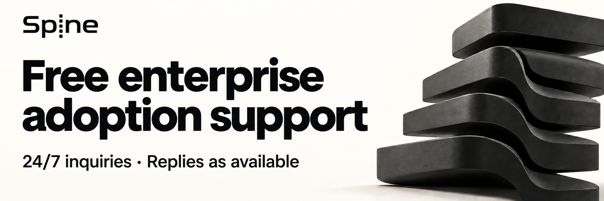
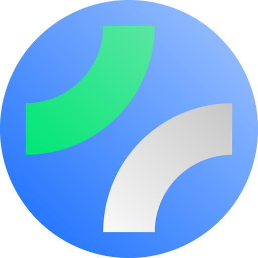

<p align="center">
  <a href="README.md">한국어</a> | <a href="README.en.md">English</a> | 日本語 | <a href="README.zh-Hans.md">简体中文</a> | <a href="README.zh-Hant.md">繁體中文</a>
</p>

# 🦴 Spine
<p align="center">
  
</p>

**Spineは、リクエストの実行フローを明示するバックエンドフレームワークです。**  
リクエストがどのように解釈され、実行されるのかを隠しません。

## 現在のチャネル

**RC** | 公開済みコアタグ [`v0.7.1-rc.1`](https://github.com/NARUBROWN/spine/tree/v0.7.1-rc.1)

他のチャネル | [Preview](https://github.com/NARUBROWN/spine/tree/preview) | [Stable](https://github.com/NARUBROWN/spine/tree/main)

## コアコンセプト

- 実行順序と責務をコード構造として固定します
- メソッドシグネチャがAPIの契約です
- `path.*`、`query.*`、`httperr.*`のセマンティック型を使用します

## 推奨環境

- 推奨Goバージョン: **1.27.3**

## Spine CLI で始める

```sh
go install github.com/NARUBROWN/spine-cli/cmd/spine@v0.4.3-rc.3
spine version
spine new todo-api --module github.com/acme/todo-api --channel rc --no-interactive
cd todo-api
go get github.com/NARUBROWN/spine@v0.7.1-rc.1 github.com/NARUBROWN/spine-echo-platform@v0.2.0-rc.1
go mod tidy
spine dev
```

```sh
curl http://localhost:8080/health
```

使用するコアとプラットフォームのバージョンは生成された `go.mod` で確認してください。

本番環境では Stable を使用してください。`--channel rc` は公開された RC と正式版のうち最新のタグを選ぶため、正式版のコアが選ばれる場合があります。上の `go get` でコアと Echo プラットフォームを検証対象の RC タグに固定します。

## リンク

- 公式サイト: https://spine.na2ru2.me/ja/
- Spine CLI（プロジェクト生成・実行契約の検査）: https://github.com/NARUBROWN/spine-cli
- Bun ORM + Swagger統合サンプルプロジェクト: https://github.com/NARUBROWN/spine-user-demo
- Kafka MSAサンプルプロジェクト: https://github.com/NARUBROWN/spine-simple-msa-demo
- シンプルなWebSocketチャットのサンプルプロジェクト: https://github.com/NARUBROWN/spine-simple-chat-demo

---

Spine `v0.7.1` の[コントローラーでのルート登録例](docs/migration/controller-routes.md)を参照してください。

## 企業導入の無償技術サポート

[](https://github.com/NARUBROWN/spine/issues/new?title=%5BAdoption%20support%5D)

SpringやNestJSで慣れ親しんだビジネスアーキテクチャと開発方法を、Goでも活かせるよう支援します。
Spineの導入を検討中、または利用中の企業や開発チームは、開発者による無償サポートを利用できます。
参加企業数の上限や、一律の支援終了期限は設けません。

- サービスにSpineを適用できるか検討し、コントローラー、サービス、リポジトリの役割と依存関係を確認します。
- 初期設定や関連コードをレビューし、依存性注入（DI）やフレームワークの利用で困っている点を確認します。
- 問題を再現し、原因に応じて回避策や修正方法を検討します。

お問い合わせは24時間365日受け付けます。開発者が対応可能な時間に確認し、応答時間や復旧時間は保証しません。
文章、コード、ログを使った非同期のやり取りを基本とし、追加の議論が必要な場合は打ち合わせの日程を相談します。

本番環境への影響と回避策の有無で優先順位を決めます。
同じ優先順位では、受付順と他の利用者への影響も考慮します。

| お問い合わせの種類 | 判断基準 |
|---|---|
| 緊急 | 本番サービスの主要機能が停止している、またはデータ整合性の問題が発生している場合 |
| 導入を妨げる問題 | ビルド、起動、主要機能のエラーにより導入や開発を進められない場合 |
| 一般 | 使い方や設計の相談、関連コードのレビュー、回避策のあるエラー |
| 改善提案 | 新機能、使いやすさ、ドキュメント、サンプルに関する提案 |

企業側の開発チームが業務機能の実装とサービス運用を担当し、インフラや外部サービスの費用を負担します。
プロジェクト全体の開発、常時運用の代行、企業専用機能の長期開発が必要な場合は、支援範囲を別途相談してください。

**[導入相談と技術サポートへのお問い合わせ](https://github.com/NARUBROWN/spine/issues/new?title=%5BAdoption%20support%5D)**

サービス概要、現在の技術構成、導入予定の範囲、質問をお知らせください。
エラーの場合は、SpineとGoのバージョン、期待する動作と実際の動作、最小限の再現手順を添えてください。
GitHub Issuesは公開されます。機密情報を除いた概要や最小限の再現コードを共有してください。

## 支援

<p align="center">
  <a href="https://fossforall.org/">
    
  </a>
</p>

**Spineは[FOSS for All Microgrants 2026](https://fossforall.org/docs/microgrants/2026/#spine)の支援対象プロジェクトに選定されました。**

[FOSS for All](https://fossforall.org/)は、持続可能な自由・オープンソースのエコシステムに向けて、
プロジェクトやコミュニティの開発と運営を支援しています。
Spineを支援してくださるFOSS for Allと寄付者の皆さまに感謝します。

<sub>ロゴ出典：<a href="https://fossforall.org/android-chrome-512x512.png">FOSS for All公式サイト</a>。
FOSS for Allロゴの著作権はFOSS for Allに帰属します（© FOSS for All）。
このロゴはSpineのMITライセンスの対象には含まれません。
<a href="assets/foss-for-all/README.md">ロゴの出典と権利表記</a>。</sub>

---

## ライセンス

MIT
