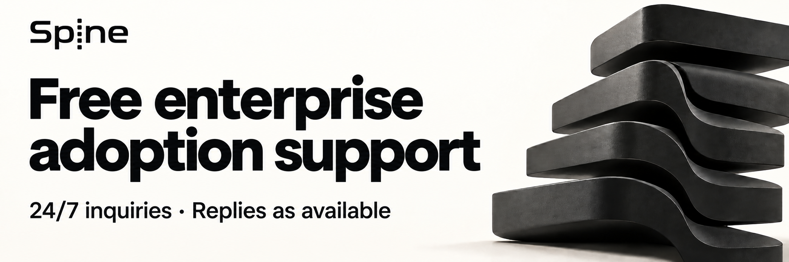
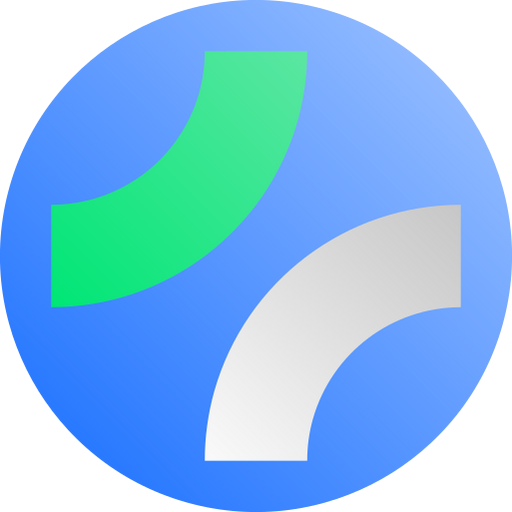

English | [Korean](docs/ko/README.md) | [Japanese](docs/ja/README.md) | [Simplified Chinese](docs/zh-Hans/README.md) | [Traditional Chinese](docs/zh-Hant/README.md)

# 🦴 Spine
<p align="center">
  
</p>

**Spine is a backend framework that makes request execution explicit.**  
It does not hide how a request is resolved and executed.

## Current channel

**Preview development source**, targeting `v0.7.6`.

This branch extends `v0.7.6-preview.1` with application DI publishing, separate HTTP context views and transport-specific WS/event contexts. These source APIs are not implied to exist in the previously published tag. Read the [current migration guide](docs/migration/v0.7.6.md) and verify the exact version combination you install.

Other channels: [RC](https://github.com/NARUBROWN/spine/tree/rc) and [Stable](https://github.com/NARUBROWN/spine/tree/main).

## Core ideas

- Fixed execution order and responsibilities
- Method signature is the API contract
- Semantic input types: `input.Path`, `input.Query`, `input.Header`, `input.Body`, `httperr.*`

## Recommended environment

- Recommended Go version: **1.27.3**

## Run the source demo

With this core and compatible platform checkouts selected in a development workspace:

```sh
go -C cmd/demo run .
curl http://127.0.0.1:8080/health
```

See [demo setup](docs/examples/demo.md), [all documentation](docs/README.md), [context ownership](docs/guides/contexts.md) and [tests](docs/testing/README.md). The independent [Spine CLI](https://github.com/NARUBROWN/spine-cli) generates released application layouts; source candidates require a CLI that understands their contracts.

## Links

- Official site: https://spine.na2ru2.me/en/
- Spine CLI (project generation and execution-contract inspection): https://github.com/NARUBROWN/spine-cli
- Bun ORM + Swagger integration example project: https://github.com/NARUBROWN/spine-user-demo
- Kafka MSA example project: https://github.com/NARUBROWN/spine-simple-msa-demo
- Simple WebSocket chat example project: https://github.com/NARUBROWN/spine-simple-chat-demo

---

See the [controller route registration example](docs/migration/controller-routes.md) for the current source API.

## Free enterprise adoption support

[](https://github.com/NARUBROWN/spine/issues/new?title=%5BAdoption%20support%5D)

Bring the business architecture and development practices you know from Spring or NestJS to Go.
Any company or development team evaluating or using Spine can request free support directly from the maintainer.
There is no limit on the number of participating companies and no fixed support end date.

- Assess whether Spine fits your service and review the responsibilities and dependencies of controllers, services, and repositories.
- Review initial setup and relevant code to help with dependency injection (DI) and framework usage.
- Reproduce errors and assess workarounds or fixes based on the cause.

Submit inquiries 24/7. The maintainer responds when available, with no guaranteed response or recovery time.
Support takes place asynchronously through text, code, and logs. Meetings can be arranged when further discussion is needed.

Inquiries are prioritized by production impact and available workarounds.
Within the same priority, arrival order and the impact on other users are also considered.

| Inquiry type | Criteria |
|---|---|
| Urgent | A core production function is unavailable or a data integrity incident is in progress |
| Adoption blocker | A build, startup, or core function error prevents adoption or development |
| General | Usage or architecture questions, focused code reviews, or errors with a workaround |
| Improvement | Suggestions for features, usability, documentation, or examples |

Your team develops business features, operates the service, and pays for infrastructure and external services.
Full project development, continuous operations, or ongoing development of features specific to your company require a separate scope discussion.

**[Start an adoption or support inquiry](https://github.com/NARUBROWN/spine/issues/new?title=%5BAdoption%20support%5D)**

Describe your service, current stack, intended adoption scope, and questions.
For errors, include your Spine and Go versions, expected and actual behavior, and minimal reproduction steps.
GitHub Issues are public. Share a sanitized summary or minimal reproduction without confidential information.

## Support

<p align="center">
  <a href="https://fossforall.org/">
    
  </a>
</p>

**Spine has been selected as a recipient of [FOSS for All Microgrants 2026](https://fossforall.org/docs/microgrants/2026/#spine).**

[FOSS for All](https://fossforall.org/) supports the development and operation of projects and communities
to help sustain the free and open source ecosystem.
Thank you to FOSS for All and its donors for supporting Spine.

<sub>Logo source: <a href="https://fossforall.org/android-chrome-512x512.png">the official FOSS for All website</a>.
The FOSS for All logo is copyright © FOSS for All and is not covered by Spine's MIT license.
<a href="docs/attribution.md">Logo source and attribution</a>.</sub>

---

## License

MIT
