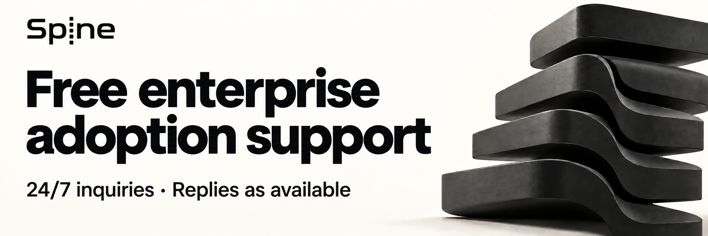

<p align="center">
  <a href="README.md">한국어</a> | <a href="README.en.md">English</a> | <a href="README.ja.md">日本語</a> | <a href="README.zh-Hans.md">简体中文</a> | 繁體中文
</p>

# 🦴 Spine
<p align="center">
  
</p>

**Spine 是一個讓請求執行流程清楚可見的後端框架。**  
它不會隱藏請求如何解析與執行。

## 目前管道

**Preview** | 已發布的核心標籤 [`v0.7.2-preview.3`](https://github.com/NARUBROWN/spine/tree/v0.7.2-preview.3)

下一個原始碼候選版本為 `v0.7.6-preview.1`，目標正式版本為 `v0.7.6`。破壞性變更請參閱[遷移指南](docs/migration/v0.7.6.md)。此標籤尚未發布。

其他管道 | [RC](https://github.com/NARUBROWN/spine/tree/rc) | [Stable](https://github.com/NARUBROWN/spine/tree/main)

## 核心理念

- 透過程式碼結構固定執行順序與職責
- 方法簽章即為 API 契約
- 使用 `path.*`、`query.*`、`httperr.*` 語意型別

## 建議環境

- 建議 Go 版本：**1.27.3**

## 使用 Spine CLI 開始

```sh
go install github.com/NARUBROWN/spine-cli/cmd/spine@v0.4.4-preview.5
spine version
spine new todo-api --module github.com/acme/todo-api --channel preview --no-interactive
cd todo-api
spine dev
```

```sh
curl http://localhost:8080/health
```

請在產生的 `go.mod` 中查看應用程式使用的核心和平台版本。

`--channel preview` 會解析持續更新的開發分支。

## 連結

- 官方網站：https://spine.na2ru2.me/zh-Hant/
- Spine CLI（專案產生與執行契約檢查）：https://github.com/NARUBROWN/spine-cli
- Bun ORM + Swagger 整合範例專案：https://github.com/NARUBROWN/spine-user-demo
- Kafka MSA 範例專案：https://github.com/NARUBROWN/spine-simple-msa-demo
- 簡易 WebSocket 聊天範例專案：https://github.com/NARUBROWN/spine-simple-chat-demo

---

請參閱 Spine `v0.7.2` 的[控制器路由註冊範例](docs/migration/controller-routes.md)。

## 企業導入免費技術支援

[](https://github.com/NARUBROWN/spine/issues/new?title=%5BAdoption%20support%5D)

協助企業與開發團隊將熟悉的 Spring 或 NestJS 業務架構及開發方式延續到 Go。
正在評估或使用 Spine 的企業與開發團隊，皆可直接向開發者申請免費技術支援。
不限制參與企業的數量，也不設統一的支援終止期限。

- 評估 Spine 是否適合你的服務，並檢視控制器、服務、儲存庫的職責與相依關係。
- 檢視初始設定及相關程式碼，協助處理相依性注入（DI）或框架使用上的問題。
- 重現錯誤，並依原因評估替代方案或修正方法。

全天候受理諮詢。開發者於時間允許時處理，不保證固定回應時間或復原時間。
以文字、程式碼及日誌的非同步溝通為主，需要進一步討論時再協調會議時間。

依正式環境影響及是否有替代方案決定優先順序。
同一優先順序內，也會考量受理順序及對其他使用者的影響。

| 諮詢類型 | 判斷依據 |
|---|---|
| 緊急 | 正式環境服務的核心功能中斷，或正在發生資料一致性問題 |
| 導入受阻 | 建置、啟動或核心功能錯誤導致無法繼續導入或開發 |
| 一般 | 使用或架構問題、相關程式碼審查、已有替代方案的錯誤 |
| 改善建議 | 關於新功能、易用性、文件或範例的建議 |

企業開發團隊負責業務功能開發與服務營運，並負擔基礎設施及第三方服務費用。
整個專案的開發、持續代維運或企業專屬功能的長期開發，需要另行商定支援範圍。

**[諮詢導入方案或尋求技術支援](https://github.com/NARUBROWN/spine/issues/new?title=%5BAdoption%20support%5D)**

請說明服務概況、目前技術組合、預計導入範圍與問題。
回報錯誤時，請提供 Spine 與 Go 版本、預期與實際行為，以及最小重現步驟。
GitHub Issues 為公開內容。請分享已移除機密資訊的摘要或最小重現程式碼。

## 支持

<p align="center">
  <a href="https://fossforall.org/">
    
  </a>
</p>

**Spine 已入選 [FOSS for All Microgrants 2026](https://fossforall.org/docs/microgrants/2026/#spine) 資助專案。**

[FOSS for All](https://fossforall.org/) 支持專案與社群的開發及營運，推動自由與開源生態的永續發展。
感謝 FOSS for All 及捐贈者對 Spine 的支持。

<sub>標誌來源：<a href="https://fossforall.org/android-chrome-512x512.png">FOSS for All 官方網站</a>。
FOSS for All 標誌的著作權歸 FOSS for All 所有（© FOSS for All），不屬於 Spine 的 MIT 授權範圍。
<a href="assets/foss-for-all/README.md">標誌來源及著作權說明</a>。</sub>

---

## 授權

MIT
