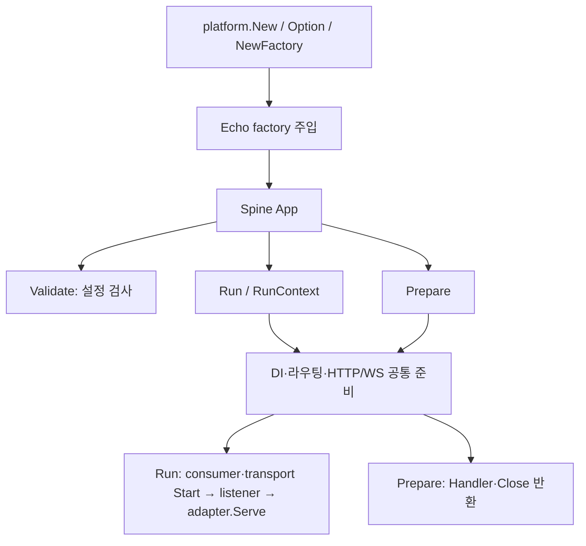

# Echo 플랫폼으로 전환하기

현재 개발 소스의 HTTP 계약 정식 경로는 `github.com/NARUBROWN/spine/adapter/http`이며 Go 패키지 이름은 `httpadapter`입니다. 기존 `github.com/NARUBROWN/spine/adapter`는 같은 타입과 오류를 재노출하는 호환 경로로 유지합니다. 아래에 기록된 Spine v0.6.0·Echo 플랫폼 v0.1.0 조합은 기존 경로를 그대로 사용할 수 있습니다. 전체 계약 분류는 [adapter 문서](../../adapter/README.md)를 참고하세요.

Spine `v0.6.0`부터 새 프로젝트의 공식 시작 경로는 Spine CLI의 `spine new`입니다. CLI가 Echo 플랫폼 연결과 의존성을 구성합니다. 이 문서는 기존 앱의 전환과 직접 플랫폼을 연결하는 방법을 설명합니다.

Spine `v0.6.0`과 Echo 플랫폼 `v0.1.0`의 HTTP 계약 `spine.http-adapter/v2`를 기준으로 합니다. HTTP 실행 계약은 Spine 모듈의 공개 `adapter` 패키지에서 관리하며, 플랫폼은 Spine과 Echo를 공개 의존성으로 가져옵니다. 플랫폼의 go.mod에는 로컬 replace가 없습니다.

## 새 프로젝트 생성

[Spine CLI `v0.4.0`](https://github.com/NARUBROWN/spine-cli/releases/tag/v0.4.0)을 설치합니다. `new`는 Spine `v0.6.0`, Echo 플랫폼 `v0.1.0`과 Echo `v5.4.4`를 함께 구성합니다.

```sh
go install github.com/NARUBROWN/spine-cli/cmd/spine@v0.4.0
spine version
spine new todo-api --module github.com/acme/todo-api
cd todo-api
spine dev
```

다른 터미널에서 `curl http://localhost:8080/health`로 `200 OK`와 `{"status":"ok"}` 응답을 확인합니다. 생성된 `go.mod`에는 Spine `v0.6.0`과 Echo 플랫폼 `v0.1.0`이 있어야 합니다.

기본 `new`는 플랫폼 연결, 의존성 설치, 정적 계약 검사와 빌드를 완료한 뒤 프로젝트를 생성합니다. 애플리케이션 초기화, 테스트나 리스너는 실행하지 않습니다. 파일만 생성하는 `--skip-install`을 사용했을 때만 생성 후 `go mod tidy`를 별도로 실행합니다.

## 기존 앱의 플랫폼 연결

기존 Go 모듈에 수동으로 연결할 때는 플랫폼을 의존성으로 추가합니다.

```sh
go get github.com/NARUBROWN/spine-echo-platform@v0.1.0
```

앱 생성 코드를 다음과 같이 바꿉니다. 기존 생성자, 컨트롤러와 라우트 등록은 이어서 사용합니다.

```go
import platform "github.com/NARUBROWN/spine-echo-platform"

app := platform.New()
```

직접 조립할 때는 같은 구성을 명시할 수 있습니다.

```go
import (
    "github.com/NARUBROWN/spine"
    platform "github.com/NARUBROWN/spine-echo-platform"
)

app := spine.New(platform.Option())
```

`spine.New()`는 HTTP 구현을 선택하지 않는 커널 생성자입니다. HTTP를 활성화하면서 factory를 지정하지 않으면 Validate, Prepare와 Run에서 `adapter.ErrInvalidAdapter`로 실패합니다. HTTP 없는 워커는 `spine.New()`를 사용합니다. 다른 구현을 연결할 때는 `spine.WithHTTPAdapter(factory)`로 주입합니다.

이 저장소의 demo는 `spine.New(platform.Option())`로 factory를 명시적으로 조립합니다. CLI `v0.4.0`은 이 구성과 `platform.New()`를 모두 인식합니다. CI도 CLI `v0.4.0`과 플랫폼 `v0.1.0`으로 검사합니다. 생성 템플릿과 분석 범위는 [CLI 문서](https://github.com/NARUBROWN/spine-cli#readme)를 따릅니다.

## App의 생성과 호출 구조

`platform.New(options...)`는 `spine.New(platform.Option(options...))`를 호출하고, Option은 Echo factory를 `spine.WithHTTPAdapter`로 주입합니다. 두 생성자 모두 같은 Spine App을 반환합니다. 생성 단계에서는 listener를 열지 않습니다.



일반 HTTP 요청은 Echo → 플랫폼 입력 뷰 → 커널 HTTPContext → Spine Pipeline 순서로 실행합니다. 컨트롤러 반환값과 오류는 커널에서 응답을 준비하고, BeforeResponse 이후 플랫폼 writer로 출력합니다. Run의 HTTP 종료는 어댑터가 처리하고, Prepare의 외부 서버 요청은 준비 결과가 수명을 추적합니다. WS 연결과 앱 자원 정리는 커널이 관리합니다.

## 계약과 구현의 책임

| Go 패키지 | 책임 | 배포 위치 |
|---|---|---|
| `adapter` | 요청 입력, 실제 응답 writer, factory, 기능 및 서버 수명 계약 | Spine 모듈 |
| `spine` | DI, 라우팅, 요청 store, EventBus, 파이프라인, 응답 staging과 실행 조정 | Spine 모듈 |
| `platform` | EchoAdapter 구현, DTO/multipart 바인딩, 실제 HTTP 출력과 편의 생성자 | Echo 플랫폼 모듈 |
| `echo` | native 훅에서 사용하는 Echo API | Labstack Echo 모듈 |

계약 소스는 [Spine 저장소](https://github.com/NARUBROWN/spine)의 공개 `adapter` 패키지에 있고 커널과 함께 버전을 관리합니다. 별도 계약 저장소나 Go 모듈은 사용하지 않습니다. 계약 패키지는 표준 라이브러리만 참조하며, 커널은 Echo와 플랫폼 모듈을 import하지 않습니다.

구현 소스는 별도 [Echo 플랫폼 저장소](https://github.com/NARUBROWN/spine-echo-platform)에서 관리합니다. Go 패키지 이름은 `platform`이고, native Labstack Echo의 패키지 이름은 `echo`입니다. 기존 서버 API를 Spine 계약에 맞게 연결하는 책임은 플랫폼에 있습니다.

플랫폼은 Echo v5.4.4를 사용합니다. 공개 adapter 계약은 v2이며 native Echo 확장 코드는 아래 typed 옵션을 사용합니다. Go 1.25.5 최소 설정도 유지합니다.

ASGI의 앱과 서버 분리, 요청과 연결의 수명 및 시작과 종료 책임을 참고합니다. **이번 작업은 Python ASGI와의 호환을 의미하지 않습니다.** 현재 HTTP 구현은 Echo 플랫폼이며, 자체 `net/http` 플랫폼 구현은 후속 작업입니다.

## 리스너 없이 앱 준비하기

`App.Prepare(ctx, options)`는 리스너 없이 앱을 준비하고 `Handler()`와 `Close(ctx)`를 반환합니다. `spine.New(...)`와 `platform.New()`가 반환하는 `App`이 직접 제공하는 API이며, 별도 지원 여부 검사는 없습니다. 일반 서버 실행은 기존처럼 `app.Run(options)`를 사용합니다.

아래는 `/health` 라우트가 등록된 앱을 테스트하는 예입니다. HTTP를 사용하려면 `boot.Options.HTTP`를 지정해야 합니다.

```go
options := boot.Options{HTTP: &boot.HTTPOptions{}}
prepared, err := app.Prepare(context.Background(), options)
if err != nil {
    t.Fatal(err)
}
t.Cleanup(func() {
    ctx, cancel := context.WithTimeout(context.Background(), 3*time.Second)
    defer cancel()
    if err := prepared.Close(ctx); err != nil {
        t.Error(err)
    }
})

recorder := httptest.NewRecorder()
prepared.Handler().ServeHTTP(recorder, httptest.NewRequest("GET", "/health", nil))
if recorder.Code != http.StatusOK {
    t.Fatalf("status = %d", recorder.Code)
}
```

Prepare와 준비 결과의 수명 규칙은 다음과 같습니다.

- **준비:** DI, 경로와 HTTP/WS 및 필요한 consumer readiness를 구성합니다. 프레임워크의 listener와 OS 신호 구독, consumer와 custom transport의 Start는 실행하지 않습니다. publisher 구성, broker readiness와 custom Init은 실행될 수 있으며 설정에 따라 네트워크 연결이 발생할 수 있습니다.
- **설정과 context:** 등록 목록과 boot 옵션을 복사합니다. 이후 원본 등록의 변경은 다음 Prepare에 반영됩니다. 생성자와 인터셉터 인스턴스, 사용자 제공 transport/dialer 자체는 복제하지 않습니다. 등록 변경과 Prepare를 동시에 실행하지 않습니다. 준비 context는 초기화 중 취소에 사용하고 HTTP 요청은 원래 request context를 유지합니다.
- **Handler:** 같은 실행 진입점을 반환합니다. HTTP가 비활성화돼 있으면 nil입니다. 외부 서버와 연결할 때는 반환된 Handler를 사용해야 앱이 요청 수명을 추적할 수 있습니다. WS 업그레이드에 필요한 raw writer 기능도 유지합니다.
- **Close:** 새 요청을 503으로 거부하고 WS를 종료합니다. 진행 중인 HTTP 요청이 끝난 뒤 consumer, custom transport와 publisher를 정리합니다. 호출 context는 완료 대기만 제한하므로 시간이 초과돼도 정리는 계속됩니다. 이후 Close로 완료를 다시 기다릴 수 있습니다. 완료한 정리를 반복하지 않고 정리 오류를 보존합니다.
- **소유권:** 준비에 실패하면 성공적으로 획득한 프레임워크 자원을 정리합니다. 준비에 성공하면 호출자가 Close해야 합니다. 외부 HTTP 서버의 listener, TLS와 timeout 및 임의 DI 객체의 자원은 호출자가 관리합니다. Close는 외부 서버의 listener를 닫지 않습니다.

HTTP 없는 앱도 Prepare와 Close를 사용할 수 있습니다. 이 경우 Handler는 nil이고 준비한 custom transport에는 Init과 Stop을 호출합니다. Run과 RunContext는 같은 준비 경로를 사용하며, 준비에 성공한 뒤 consumer와 custom transport를 시작하고 마지막으로 HTTP listener를 엽니다. 관리 실행의 OS 신호 구독은 준비 전에 수행합니다.

nil context는 `ErrInvalidContext`로 거부하며 준비가 실패하면 nil 결과와 오류를 반환합니다. 기존 `RunContext(nil, options)`의 background 동작은 유지합니다.

## 유지되는 동작과 native 확장

바인딩과 응답 형식, 응답 staging, 인터셉터 순서, 제한값과 정상 종료 동작을 유지합니다. staging은 커널에 남고 실제 HTTP 출력은 플랫폼이 처리합니다. WebSocket 업그레이드는 공개 계약으로 연결하며 Gorilla 메시지 엔진과 연결 종료는 커널에 유지합니다.

`app.Transport(func(any))`는 제거했습니다. Echo 설정은 플랫폼의 `WithEcho(func(*echo.Echo))` 옵션으로 등록합니다. native Echo 경로는 Spine의 HTTP 인터셉터, 본문 제한과 staging을 거치지 않습니다. native Echo store와 Spine 요청 store는 분리하므로 공유 값은 표준 request context로 전달합니다. DTO의 `param` 태그는 native 파라미터를, Spine path 인자는 커널 라우팅 결과를 사용하는 기존 차이도 유지합니다.

```go
import "github.com/labstack/echo/v5"

app := platform.New(platform.WithEcho(func(e *echo.Echo) {
    e.GET("/native", func(ctx *echo.Context) error {
        return ctx.String(200, "native")
    })
}))
```

Echo v4에서 사용하던 handler와 middleware의 `echo.Context`는 `*echo.Context`로 바꿉니다. `HTTPErrorHandler`는 `func(ctx *echo.Context, err error)` 순서이고 logger는 `log/slog`입니다. 경로 인자는 `PathValues()`로 조회하며 `Response()`는 `http.ResponseWriter`를 반환합니다. 응답 상태를 읽을 때는 `echo.UnwrapResponse`를 사용하고, native 응답 wrapper는 `Unwrap() http.ResponseWriter`를 제공해야 합니다.

## v2 계약 변경

| v1 | v2 |
|---|---|
| `spine.NewWithHTTPAdapter(factory)` | `spine.New(spine.WithHTTPAdapter(factory))` |
| `spine.Prepare(ctx, app, options)`와 선택적 `ApplicationPreparer` | `app.Prepare(ctx, options)` |
| `App.Transport(func(any))`, `Config.NativeHooks` | 플랫폼의 typed `WithEcho` 옵션 |
| `ResponseWriter.WriteJSON(int, any)` | `WriteJSON(int, json.RawMessage)` |
| `ctx.Set/Get("spine.response_writer", ...)` | HTTP 전용 `core.HTTPResponseContext`의 writer 접근자 |
| `ctx.Set("spine.params"/"spine.pathKeys", ...)` | `ExecutionContext.SetRoute(params, pathKeys)`와 typed 필드 |
| `PostExecutionHook.AfterExecution(ctx, results, err)` | 성공 후처리 `AfterExecution(ctx)` |

HTTP, WS와 컨슈머의 사용자 확장 저장소는 `Set/Get`을 유지합니다. 사용자 저장소의 값은 프레임워크 writer나 라우팅 상태를 바꾸지 않습니다. HTTP writer를 공통 ExecutionContext에 요구하지 않으므로 WS·컨슈머는 HTTP 응답 계약을 구현하지 않습니다. 직접 실행 컨텍스트를 구현한 경우 새 `SetRoute` 메서드를 구현해야 합니다.

동적 반환값의 JSON 직렬화는 core에서 수행합니다. Echo의 JSONSerializer에는 원래 DTO 대신 json.RawMessage를 전달하므로, 사용자 serializer도 이 타입을 처리해야 합니다. 상태·쿠키·직렬화 오류를 응답 준비 중 발견하고, BeforeResponse 뒤에 flush하는 순서는 유지합니다. 플랫폼은 Echo의 JSON 출력 경로로 최종 Content-Type·개행·pretty 출력과 실제 쓰기를 처리합니다. 사용자 serializer의 오류는 실제 출력 단계에서도 발생할 수 있습니다. DTO 바인딩, 동적 DI와 리플렉션 인자·반환값에 필요한 any는 해당 경계에 남습니다.

## 프레임워크 소스 개발과 검증

두 저장소를 함께 수정할 때는 형제 폴더에 체크아웃합니다.

```text
VscodeProjects/
  spine/
  spine-echo-platform/
```

Spine 저장소의 `test`, `cmd/demo`, `cmd/reference`와 `examples/security-config`는 각각 별도 Go 모듈입니다. 이 개발용 모듈의 `replace`는 위 두 checkout을 검사하기 위한 설정입니다. 공개 플랫폼의 go.mod는 공개 Spine 버전을 사용하고 `replace`를 포함하지 않습니다. 의존 모듈의 `replace`는 소비자 앱에 전파되지 않으므로 공개 버전은 별도 소비자에서 검증합니다. 로컬 `go.work`는 커밋하지 않습니다.

루트의 `go test ./...`는 중첩 모듈을 포함하지 않습니다. 루트와 플랫폼, 위 4개 개발용 모듈을 각각 검사합니다. HTTP/WS E2E는 계속 실제 `cmd/demo`를 기준으로 실행합니다.

```sh
bash scripts/check-module-boundaries.sh
spine context --root cmd/demo --json
spine contract check --root cmd/demo --warnings-as-errors --json
spine verify --root cmd/demo --warnings-as-errors --json
spine contract probe --root cmd/demo --json
go -C cmd/demo test . -run '^TestDemoE2E_' -count=1 -timeout=90s
```

CLI 정적 분석, 부분 runtime probe와 실제 E2E는 별도 검증 결과입니다. Prepare 추가가 CLI probe의 HTTP 실행 분석 범위를 확장하는 것은 아닙니다.

공개 버전의 설치와 실행은 예제 go.mod에 지정한 core·플랫폼 버전으로 따로 검사합니다. 정식 릴리스 소비자는 Spine v0.6.0과 플랫폼 v0.1.0을 사용합니다.

```sh
bash scripts/check-published-demo.sh
```

이 검사는 실제 demo를 저장소 밖으로 복사하고 `replace`와 직접 선언한 Spine 의존성을 제거합니다. `go.work`와 기존 모듈 캐시 없이 플랫폼을 설치해 필요한 Spine 버전이 선택되는지 확인합니다. 같은 demo 전체의 vet/race와 HTTP/WS, SIGINT 및 Prepare E2E를 실행하며, 임시 소스와 캐시는 검사 후 제거합니다. 전체 SIGINT 검증은 Unix에서 실행합니다.

## 검증된 범위와 남은 작업

v2 소스는 6개 모듈의 로컬 vet/race와 CLI strict contract check·verify를 통과했습니다. race는 최상위 309개와 하위 사례 87개를 포함하며, 실제 cmd/demo의 HTTP/WS·SIGINT 종료·Prepare E2E도 검증했습니다. 실브로커가 필요한 Kafka/RabbitMQ 테스트 2개는 환경이 없어 생략했습니다. 최신 커밋의 원격 CI 결과는 [PR #10의 Checks](https://github.com/NARUBROWN/spine/pull/10/checks)에서 별도로 확인합니다.

CI의 플랫폼 단독 vet/unit/race는 `RUNNER_TEMP` 아래의 임시 Go workspace로 두 checkout을 연결해 PR의 Spine 소스를 검사합니다. 플랫폼 검사 전에 Spine이 workspace의 주 모듈로 선택됐는지도 확인합니다. 이 workspace는 플랫폼 명령에만 적용합니다.

모듈 정합성과 공개 소비자 검사는 `GOWORK=off`를 유지합니다. 공개 플랫폼의 go.mod에 로컬 `replace`를 넣지 않고도 PR 커널과의 호환성 검사 및 공개 의존 버전 검사를 각각 수행합니다.

릴리스 변경 내용은 [Spine v0.6.0](https://github.com/NARUBROWN/spine/releases/tag/v0.6.0)과 [Echo 플랫폼 v0.1.0](https://github.com/NARUBROWN/spine-echo-platform/releases/tag/v0.1.0)에서 확인합니다.
